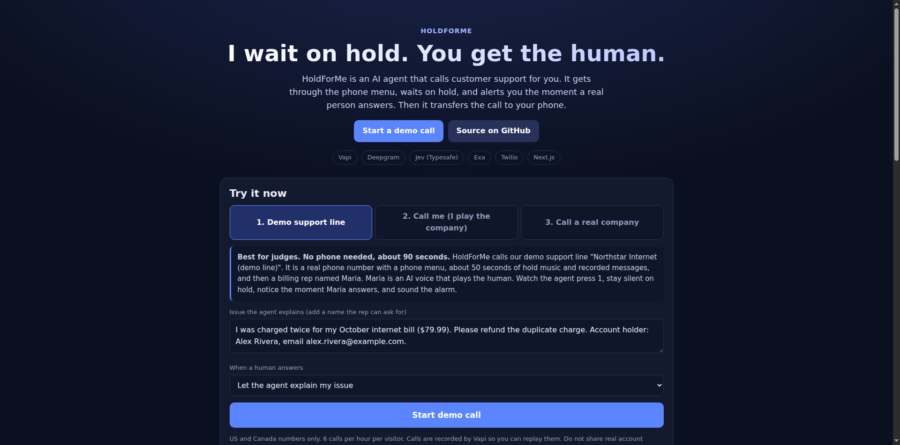
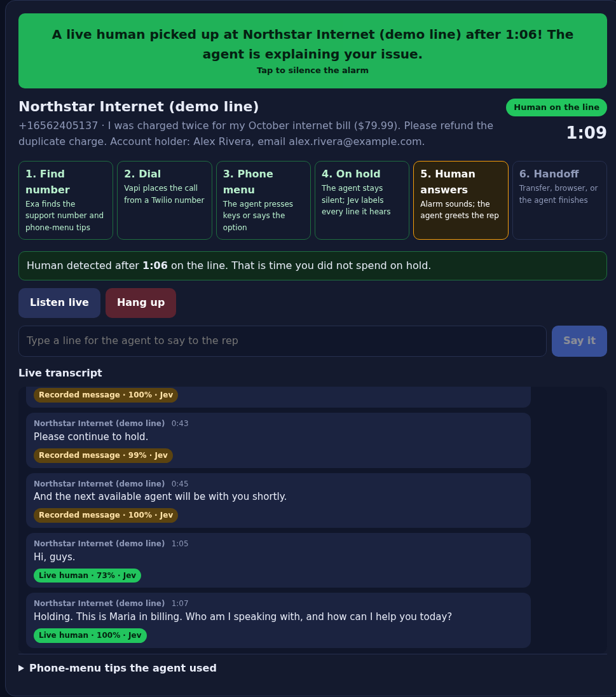
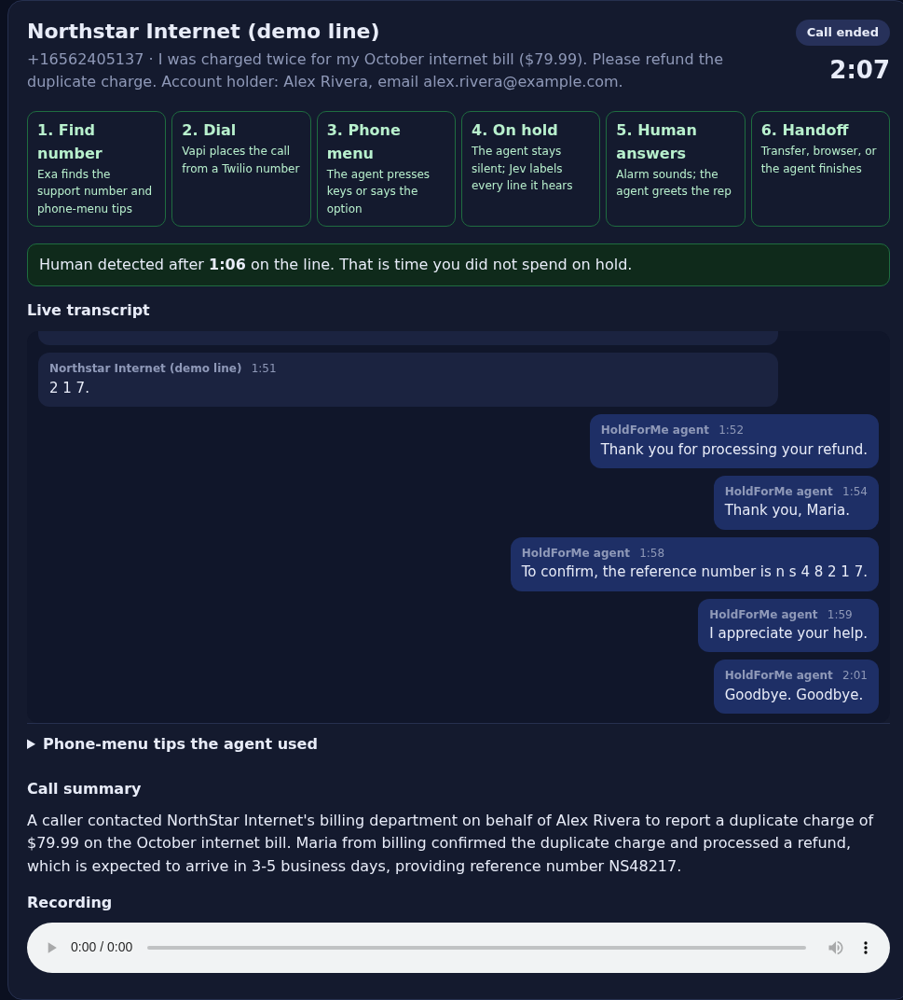
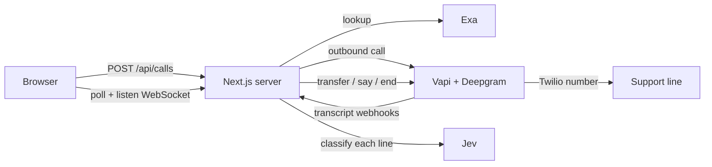

# CallOrHold4Me

**I make the call. I wait on hold. I get it done.** CallOrHold4Me is an AI agent that calls customer support for you. It gets through the phone menu and waits on hold. When a real person answers, it does one of two things:

- **Call for me:** the agent handles the whole call. It explains your issue, answers the rep's questions, gets a reference number, and hangs up. You get a summary and a recording.
- **Hold for me:** the agent alarms you and hands the human to you. The call transfers to your phone, or you listen live in the browser and type lines for the agent to say.

Live demo: **https://pragnyalabs.com/hold4me**



## Try it (judges)

Open https://pragnyalabs.com/hold4me and pick a tab in **Try it now**.

| Tab | What happens | You need |
| --- | --- | --- |
| **1. Demo support line** (start here) | The agent calls our demo line "Northstar Internet". It is a real phone number with a phone menu, about 50 s of hold music and recorded messages, then a billing rep "Maria" (an AI voice that plays the human). | Nothing. About 2 minutes. |
| **2. Call me (I play the company)** | The agent calls your phone. Read the script on the page: a menu, a hold message, then "Hi, this is Sam from billing". | A US/Canada phone |
| **3. Call a real company** | Type "call Delta about my lost bag". Exa finds the number and phone-menu tips, and the agent calls. | Patience for real hold times |

What to look for during a call:

1. The agent presses **1** on the menu, then stays silent on hold.
2. Every line the business says gets a label chip from **Jev**: hold music, recorded message, phone menu, or live human, with a score.
3. When Maria answers, the **alarm** sounds, the banner turns green, and the tab title flashes.
4. In **Call for me** mode (the default), the agent finishes the whole call: it gives the account name, gets the refund reference number, repeats it back, and hangs up. A summary and a recording follow.
5. During the call you can press **Listen live** (audio streams to your browser), type a line under **Say it**, or **Hang up**.

| Human detected | Call finished |
| --- | --- |
|  |  |

## How it works



- **Exa** finds the support number and phone-menu tips when you do not enter a number.
- **Vapi** places the call from a **Twilio** number. **Deepgram** is the transcriber (Nova-3) and the voice (Aura-2). GPT-4.1 presses keys with the `dtmf` tool and stays silent on hold.
- **Jev** (Typesafe) labels every line the business says. A human is confirmed after 2 `live_human` labels in a row, or 1 with a score of 0.85 or more. Keyword rules take over if Jev is not available.
- When a human is confirmed, the server rings the alarm and does the handoff through Vapi's live call control: transfer to your phone, keep the rep engaged while you listen, or let the agent finish.
- The demo line is a Twilio number whose Voice URL is `/api/demo-line` (TwiML: menu, hold music, recorded messages), which then dials a Vapi number answered by the "Maria" assistant.

## Limits on the public demo

US and Canada numbers only (no 900/976 lines), 6 calls per hour per visitor, 4 calls at the same time, and 20 minutes per call. These live in `LIMITS` in `lib/config.ts`. Calls are recorded by Vapi so you can replay them.

Measured cost of one demo call: about $0.18 for the CallOrHold4Me agent in Vapi, $0.08 for the AI rep, and about $0.05 in Twilio minutes (about $0.30 in total).

## Run it yourself

```bash
pnpm install
cp .env.example .env.local   # fill in keys
pnpm dev                     # http://localhost:3000
pnpm test                    # classifier and guard checks
```

Vapi webhooks need a public URL: set `PUBLIC_BASE_URL` (include the base path, if any).

### Demo support line

1. Import a Twilio number into Vapi and set `VAPI_PHONE_NUMBER_ID` (free Vapi numbers cannot dial out).
2. Buy a second Twilio number. Set its Voice URL to `$PUBLIC_BASE_URL/api/demo-line` (HTTP POST) and put it in `DEMO_LINE_NUMBER`.
3. Get a Vapi number for the rep. Put it in `DEMO_REP_NUMBER` and its id in `DEMO_REP_PHONE_NUMBER_ID`, then run:

```bash
node --env-file=.env.local scripts/setup-demo-rep.mjs
```

Hold music: a 16-second clip of Twilio's public "BusyStrings" hold music (`public/demo/hold-music.mp3`).

## Code map

| Path | Purpose |
| --- | --- |
| `lib/config.ts` | Branding, labels, thresholds, limits, demo-line script, env |
| `lib/vapi.ts` | Agent prompt and Vapi assistant, call control |
| `lib/classify.ts` | Jev classification with keyword fallback |
| `lib/guard.ts` | Phone-number checks and per-IP rate limit |
| `app/api/calls` | Start a call, read state, hang up, say a line |
| `app/api/vapi/webhook` | Call state machine and human detection |
| `app/api/demo-line` | TwiML for the demo support line |
| `components/` | Try-it form, call panel, alarm and live listen audio |

## TODO

- Talk from the browser after a human answers (today: listen live plus typed "Say it").
- Deepgram Voice Agent for voice intake (browser SpeechRecognition today).
- Your own number as caller ID.
- Post-call follow-up, for example a dispute email draft.
- Persistent call store (calls live in server memory today).
