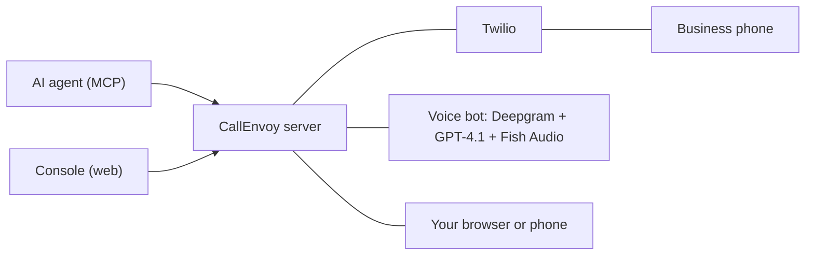

# CallEnvoy

A private phone-call server for AI agents. An agent (Claude Code, Codex, Claude Desktop, Grok, or any MCP client) asks CallEnvoy to call a business. The AI presses the menu keys, waits on hold, and talks to the person. You can get an alert, listen in, take the call over, and hand it back.

- Live at `https://pragnyalabs.com/callenvoy` (one owner; named API keys for agents, email sign-in for the console).
- Design and API follow [Call4me](https://github.com/skeptrunedev/call4me) (MIT) where that fits. Thank you to its author.
- Earlier this repository held the hackathon project HoldForMe / CallOrHold4Me.

## How it works



One Python process (FastAPI + [Pipecat](https://github.com/pipecat-ai/pipecat)) hosts the MCP endpoint, the Twilio webhooks and audio streams, one voice bot per call, the owner audio socket, web push, and the built console. Data is one SQLite file in `data/`.

Menu keys: Twilio cannot send keys on an open audio stream, and a Twilio menu ignored tones in the audio in tests. For each key press the call leaves its stream, Twilio plays the digits as real key signals, and the call joins a new stream; the next bot continues with the same context. About one second of audio is not heard during this change.

## Connect an agent

Create a key on the console page **Agents**; it shows these lines with the new key filled in.

```bash
claude mcp add --scope user --transport http callenvoy https://pragnyalabs.com/callenvoy/mcp --header "Authorization: Bearer <key>"
```

Clients that cannot send headers (Grok) use `https://pragnyalabs.com/callenvoy/mcp/<key>`. Prefer the header form: a key in a URL can end up in logs.

## Sign-in and keys

| Credential | How | Opens |
|---|---|---|
| Agent key | `Authorization: Bearer <key>` or `/mcp/<key>` | `/mcp`, `/api/calls*`, `/api/profile`, `/api/config`, `/api/caller-id*` |
| Owner session | cookie `ce_session` after an email sign-in link (30 days) | every `/api/*` route, including the owner-only `/api/keys*` and `/api/push/*` |

- Keys look like `ce_live_` + 32 characters. You can have up to 20, each with a name, a last-used time, and Disable / Enable / Delete. A key is shown once; the server stores only its SHA-256 hash.
- Upgrade from one key: at the first start with an empty key list, `CALLENVOY_API_KEY` is stored as the key "First key (.env)". Then remove it from `.env` (the server starts without it; a deleted key would come back if the list is empty again and the variable is still set).
- The console asks for an email address and mails a one-time link (15 minutes) to `OWNER_EMAIL` only. Mail settings: `OWNER_EMAIL`, `SMTP_HOST`, `SMTP_PORT` (default 587, STARTTLS), `SMTP_USER`, `SMTP_PASSWORD`, `MAIL_FROM`. At most 5 link requests per hour.
- First use without mail, or recovery: on the server, in the app folder, run `uv run python -m callenvoy.signin`. It prints a one-time sign-in link (it reads `PUBLIC_BASE_URL` from `.env`).
- A refused request gets 401 `{"error", "code"}` with `code` one of `no_credential`, `bad_key`, `key_disabled`, `malformed_key`, `session_expired`. An agent key on an owner-only route gets 403 `owner_only`; a console write from a foreign `Origin` gets 403 `bad_origin`.

Tools (prefix `callenvoy_`): `place_call`, `get_call`, `hang_up`, `list_calls`, `answer_question`, `connect_me`, `hand_back`, `get_recordings`, `get_profile`, `save_profile`, `list_voices`, `verify_number`.

## Two call modes

| Mode | The AI | You |
|---|---|---|
| `handle` (default) | Does the whole call | Can get an alert when a person answers, listen, take over, hand back |
| `transfer` | Gets through the menu and the hold, then asks the person to wait | Get an alert in the console, then a phone ring, and join |

You join in the browser (audio goes through the server; headphones recommended) or on your phone (key 1 takes over, `*` hands back).

## Alerts

Sound and browser notification while the console is open; web push when it is closed; then the phone ring. Turn them on in **Settings > Alerts on this device**. On an iPhone, web push works only after you add the console to the home screen (Share > Add to Home Screen).

## Settings

All settings have defaults, and you can change them in the console and with `callenvoy_save_profile`; most also per call. Main ones: `mode`, `reach` (`app`, `phone`, `app_then_phone`), `alert_wait_seconds`, `no_answer`, `alert_on_human`, `listen_in`, `voice`, `record_calls`, `max_minutes`, `caller_id` (`callenvoy` or your own verified number), `leave_voicemail`, and the calling profile (name, callback number, address, insurance, vehicle, travel numbers, free text). Safety limits are constants in `callenvoy/config.py` and cannot be changed through MCP.

## Voices

Ten Fish Audio voices; Hannah is the default. `callenvoy_list_voices` returns them with sample links.

| Name | Gender | Accent |
|---|---|---|
| Hannah, Sarah, Laura | female | US |
| Sophia | female | British |
| Ethan, Adrian, Jordan | male | US |
| Rohan, Vikram | male | Indian English |
| Meera | female | Indian English |

The three Indian English voices are community voices on Fish Audio; if one is removed, calls use the default voice.

## Limits

US and Canada numbers only; premium and non-US/Canada area codes are blocked. 30 minutes planned per call (extended on hold or in a live talk), 120 at most, 2 calls at one time, 240 minutes per day. Calls are recorded by default; some US states require all parties to agree to a recording, and that is the owner's duty. The server keeps a copy of each recording mp3 in `data/recordings/` (fetched from Twilio on first play) and serves it with HTTP Range, so players can seek.

## Run locally

```bash
cp .env.example .env.local   # fill in the values
set -a; . ./.env.local; set +a
pnpm --dir client install && pnpm --dir client run build
uv run uvicorn callenvoy.main:app --host 127.0.0.1 --port 3020
```

Console development without the server: `pnpm --dir client run build`, then `pnpm --dir client run mock`. The mock serves the built console with sample data at `http://localhost:3020/callenvoy/`; open `/__mock/signin` to sign in (agent key `dev-key`).

Env names are in `.env.example`. Web push keys: `uv run python -m callenvoy.push --make-keys`. Voice samples (costs a few cents of Fish credit): `uv run python -m callenvoy.make_voice_samples`.

## Tests

```bash
uv run pytest                      # service checks, no network
pnpm --dir client run typecheck
pnpm --dir client test
```

## Deploy

`deploy/deploy.sh` builds the console on your machine (Node 22.13+ and pnpm), copies the code and `client/dist` to the server, runs `uv sync`, restarts the `holdforme` systemd unit (`deploy/callenvoy.service`), and checks `/callenvoy/healthz`. The server needs `uv`, a filled `.env` (mode 600), and an nginx location `/callenvoy` that proxies to `127.0.0.1:3020` with WebSocket upgrade. For the key-in-path MCP address, add `location ~ ^/callenvoy/mcp/. { access_log off; ... }` with the same proxy lines, so that the key does not go into the access log.

## Cost (estimates)

About $0.03-0.07 per call minute (Twilio, Deepgram, GPT-4.1, Fish Audio). Your phone leg adds about $0.02 per minute while it is connected. Listening in the browser adds no provider cost.

## Not built yet

A native mobile app (the console is an Expo project, so screens and logic are shared), native push, SMS alerts, an AI that answers callbacks (callbacks forward to your phone), scheduled calls, and a keypad in the console.
